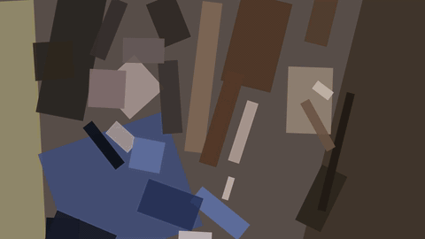
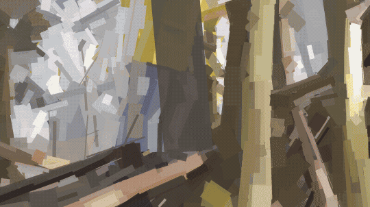
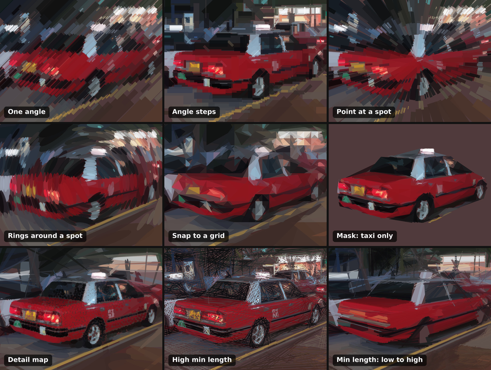

# Primitive Pictures, on the GPU

Rebuild any picture from simple shapes (triangles, rectangles, circles, curves and more), one shape at a time.

A Rust port of Michael Fogleman's [primitive](https://github.com/fogleman/primitive) that scores candidate shapes on the graphics card with [wgpu](https://wgpu.rs): about 5 million tries per second on an RTX 2060, and one shape takes roughly 25,000 tries (`-vv` prints the rate on your machine). It has two programs: the command-line `primitive-gpu`, with the original's flags plus a few new ones, and `primitive-gui`, a browser interface for pictures, videos and image sequences.


## What's new compared to the original

**About 7 to 9 times faster than the original.** The same photo, 1000 rotated rectangles at alpha 210, with the clocks in real time. The top row is the original Go program on a Ryzen 7 2700 (16 threads), and the bottom row is primitive-gpu on an RTX 2060. The search picture is 256 pixels on the left and 1024 on the right ([full-quality MP4](https://github.com/Leeuum/primitive-gallery/blob/main/images/speed-taxi.mp4)):

<a href="https://github.com/Leeuum/primitive-gallery/blob/main/images/speed-taxi.mp4"></a>

- **Video.** Scoring on the graphics card makes a whole video practical, not just a single picture. Give the GUI a video or an image sequence and it rebuilds every frame. In "build on" mode each frame adds new shapes over the frame before, so the picture changes smoothly instead of flickering; in "fresh" mode every frame starts empty and the shapes jump around.

  

- **Loops.** "Loop video" makes a clip whose last frame leads back into its first, so it repeats without a jump:

  

- **Shape rules.** Steer the look instead of leaving it all to the search: make every shape lean one way or point at a spot, set the smallest and largest size, keep shapes long and thin or chunky, snap them to a grid, or paint an area on the picture where the shapes stay or where the small detail shapes go:

  

- **Keyframes: change settings during a build.** A timeline under the picture counts the shapes, like the frames in an animation program. Click the dot beside a setting to set a keyframe at the playhead, and the build switches to that value when it reaches that shape. Number settings change smoothly between two keyframes. One picture can mix several looks: big, rough shapes for the base, then fine detail in just the area you paint. The painted area can have keyframes too. Drag the playhead back to see an earlier stage. Change or move a keyframe and only the shapes after it are built again. Restart plays the same keyframes again, so you set them up once and try as many seeds as you like. Still pictures only for now.

- **A browser GUI.** With `-lan` it works from any device on your network. Hover over a setting to see what it does. Snapshots keep up to 8 results to flick between (keys 1 to 8), and a build timer shows how long each result took, so settings are easy to compare. Export at any size up to 4K without searching again. Render straight to MP4, WebM (with the original sound), GIF or an image sequence. Save your work to a file and carry on later. PNG and SVG exports carry the settings and keyframes they were made with, so anyone can drop one onto the page and use the same recipe.

## Gallery

<p align="center">
  
  
  <br>
  
  <br>
  
  
  <br>
  
  
</p>

Some of these are stylized frames from films and TV shows, shown only to demonstrate the program. See the [gallery repository](https://github.com/Leeuum/primitive-gallery) for credits.

## Download

No install needed. Get the file for your computer from the [Releases page](https://github.com/Leeuum/primitive-gpu/releases/latest) (Windows, Mac with Apple Silicon, or Linux), unzip it, and double-click `primitive-gui`. The GUI opens in your browser. Close the small text window to stop it; it also stops by itself 10 minutes after the last browser tab closes (but not while it is still adding shapes or rendering). ffmpeg comes included. The files ending in `no-ffmpeg` are much smaller and leave it out: they work for pictures, and use the ffmpeg on your system for videos, GIFs and HEIC photos. The download has only the GUI; to use the command-line program, build it yourself (see [Building](#building)).

The first time, Windows and Mac warn you because the program is not signed:

- **Windows:** click "More info", then "Run anyway".
- **Mac:** click "Done", then open System Settings > Privacy & Security and click "Open Anyway".

`START-HERE.txt` in the download explains the rest.

## How it works

The canvas starts as the average colour of the target. The program finds the shape that brings the canvas closest to the target, adds it, and repeats. To find each shape:

1. **Random phase.** Many random shapes are scored. The best few become starting points.
2. **Climb phase.** Each starting point is nudged again and again (move a corner, rotate), keeping each nudge that improves the score.
3. **Commit.** The best shape is drawn onto the canvas.

Each shape's colour is worked out directly from the pixels under it. The score is the root-mean-square difference from the target (lower is closer).

The GPU only *ranks* candidates; the winner is drawn again on the CPU with exact whole-number maths. Triangles, rectangles, ellipses, circles and rotated rectangles use the same whole-number maths on both sides, so the GPU picks the same winners as an exact CPU search. Curves, rotated ellipses and polygons have anti-aliased edges that differ slightly between the two, so the GPU picks a different winner in about 1% of batches. `rust/check.sh` tests both.

## Speed

Average time for 50 shapes at a 256-pixel working size (Ryzen 7 2700, RTX 2060):

| Shape | combo | triangle | rect | ellipse | circle | rotated rect | curve | rotated ellipse | polygon |
| --- | ---: | ---: | ---: | ---: | ---: | ---: | ---: | ---: | ---: |
| Seconds | 0.33 | 0.33 | 0.17 | 0.19 | 0.16 | 0.21 | 0.53 | 0.38 | 0.37 |

Compared with the original Go program on the same machine (200 shapes of one kind on `examples/monalisa.png`, default settings, whole run including start-up and saving, all CPU cores for the original). Both reach about the same final score:

| Shape | Original | This port | Faster by |
| --- | ---: | ---: | ---: |
| triangle | 6.0 s | 1.3 s | 4.6x |
| rotated rect | 5.3 s | 0.8 s | 6.5x |
| curve | 7.4 s | 2.1 s | 3.5x |

## Building

To build it yourself, you need [Rust](https://rustup.rs), a graphics card with Vulkan, Metal or DirectX 12, and [ffmpeg](https://ffmpeg.org) for videos and formats such as HEIC.

```bash
cd rust
cargo build --release
```

The programs land in `rust/target/release/`. They use an `ffmpeg` placed next to them first, then the one on the system path.

## Command-line use

The command-line program is not in the download. Build it as shown above.

```bash
cd rust
target/release/primitive-gpu -i ../examples/monalisa.png -o out.png -n 100 -m 1 -v
```

| Flag | Default | Description |
| --- | --- | --- |
| `i` | n/a | input image (`-` reads standard input) |
| `o` | n/a | output file: `.png`, `.jpg`, `.svg` or `.gif` (repeatable; `-` writes SVG to standard output) |
| `n` | n/a | number of shapes (repeatable; each uses the `-m`, `-a` and `-rep` before it) |
| `m` | 1 | mode: 0=combo, 1=triangle, 2=rect, 3=ellipse, 4=circle, 5=rotatedrect, 6=beziers, 7=rotatedellipse, 8=polygon |
| `a` | 128 | shape alpha (0 lets the search choose) |
| `bg` | average | starting background colour (hex) |
| `r` | 256 | working size for the search |
| `s` | 1024 | output image size |
| `j` | all cores | number of CPU threads |
| `nth` | 1 | save every Nth frame (with `%d` in the output path) |
| `rep` | 0 | extra shapes per step with a smaller search (good for curves) |
| `metric` | squared | `squared` or `plain` (flatter, bolder shapes) |
| `score` | off | stop once the score is at or below this, e.g. 0.03 |
| `v`, `vv` | off | verbose output (`-vv` adds a timing table) |

GPU search tuning:

| Flag | Default | Description |
| --- | --- | --- |
| `chains` | 16 | hill-climbing chains per shape |
| `random` | 1000 | random tries that seed each chain |
| `age` | 100 | tries without improvement before a chain stops |
| `k` | 64 | nudges each chain tries per GPU round |
| `seed` | clock | random seed; the same seed and the same `-j` give the same picture |
| `raster` | gpu | who draws the candidate shapes: `gpu` or `cpu` (the older path) |
| `check` | off | also score every candidate exactly on the CPU and report the GPU's error (slow) |

Creative rules for the shapes (all off by default):

| Flag | Default | Description |
| --- | --- | --- |
| `angle` | off | every shape leans this way, in degrees: 0 = flat, 90 = upright (angle rules work with modes 5, 6 and 7) |
| `angle-step` | off | only angles this many degrees apart, e.g. 45; counted from `-angle` |
| `toward` | off | shapes point at a spot: `x,y` in percent of the width and height, e.g. `50,30` |
| `around` | off | shapes run in rings around a spot (`x,y` in percent) |
| `min-size` | off | smallest shape, in percent of the picture's long side |
| `max-size` | off | largest shape, in percent of the picture's long side |
| `shrink` | off | the largest size falls from `-max-size` to `-min-size` during the run (big shapes first, details last) |
| `min-ratio` | off | shapes are at least this many times as long as wide (thin strokes); modes 2, 3, 5 and 7 only |
| `max-ratio` | off | shapes are at most this many times as long as wide (1 = square); modes 2, 3, 5 and 7 only |
| `grid` | off | snap shapes to a grid of this many cells along the long side |
| `mask` | off | picture of the area where shapes may be: white = allowed |
| `detail` | off | picture of the detail area: white = small shapes (up to `-min-size`), black = big shapes (half of `-max-size` up to it) |

For example, `-m 5 -toward 75,20` makes every rectangle point at a spot in the upper right, and `-m 2 -grid 16` gives a mosaic of tiles.

GIF output animates the shapes being added. With `%d` in a PNG, JPG or SVG name, every frame is saved as its own file.

## Browser GUI

```bash
cd rust
target/release/primitive-gui            # opens http://localhost:8640 in the browser
target/release/primitive-gui -port 9000 -j 8 -no-open
target/release/primitive-gui -lan        # also lets your phone or laptop open the page
```

By default only this computer can open the page. With `-lan`, any device on the same network can use it, and the program prints the address to open there.

- **Input:** an image, a video, or a folder of pictures (an image sequence). "Open…" shows the pictures and videos in the home folder of the computer the program runs on, or uploads files from the device you use.
- **Stopping:** "Shapes" sets the most shapes per picture, "Stop at match" stops a picture once that much of it is matched (in percent, so dark and bright frames end up equally finished), "Lowest score" lets dark or nearly flat frames stop early, and "Fewest shapes" sets the least shapes a picture gets before that.
- **Shape rules:** the same creative rules as the command line (direction, size, proportions, grid), plus an area that you paint on the picture. The painted area either keeps the shapes inside it, or marks where the small shapes go while the rest gets big shapes.
- **Keyframes (still pictures):** the shape timeline under the picture has a numbered playhead. The dot beside a setting, or beside the painted area, sets a keyframe at the playhead. Its colour shows the state: yellow means a keyframe on this shape, green means keyframes elsewhere, and orange means the value changed but has no keyframe. Number settings change smoothly between keyframes. Changing, moving or deleting a keyframe keeps the shapes before it and builds the rest again when you press Play. Right-click a setting to reset it, insert or delete a keyframe, clear its keyframes, or copy and paste its value.
- **Export:** PNG, JPG, SVG or a timelapse, at any size up to 4K without a new search. A still picture exports the shapes up to the playhead.
- **Save files:** Save in the settings panel writes a `.primitive` file to go on with your work later: the settings, the keyframes, the painted areas, the shapes made so far on a still picture, and where the source file is on the computer. Tick "Include original picture" to put a copy of the picture in it too. Videos are never copied in, and they build again from the start. If the source has moved, the program asks you to find it. A save file holds a folder path, so it is for your own use.
- **Where files go:** the first time you press Save, Export or Render, the file browser asks for a folder (inside your home folder) and can make a new one. Tick "Always use this folder" and that button uses it from then on; each button keeps its own folder, and the Export section lists them to change or forget. If a file of the same name is there, Save and Export ask whether to overwrite it or save a new one next to it. "Download to this device" sends the file to the browser instead, which is handy from a phone.
- **Recipes:** PNG and SVG exports hold their recipe: the settings, the keyframes and the painted areas, with no file names, so it is safe to share. Drop one onto the page to open it with or without its recipe, or pick it with Load to put its recipe on the picture you have open. Load also takes older recipe `.json` files. Websites and chat apps often remove this data from pictures, so send the file itself (for example in a zip) to keep it.
- **Videos:** every loop adds more shapes to each frame. Each frame can start fresh or build on the one before.
- **Loop video:** in "build on" mode, makes a video that joins up when it plays in a loop. Every frame is built a second time, starting on the last frame's picture, so the end turns into the start like any other two frames.
- **Render:** saves an MP4 or WebM (with the original sound), a GIF, or an image sequence into the folder you pick. "Download to this device" saves it to `primitive` in your Videos folder (Movies on a Mac) and downloads it. Existing renders are never overwritten.

**Security:** the GUI has no password. By default it listens on this computer only. With `-lan` it listens on all network interfaces, so anyone on your network can use it and see your pictures: use `-lan` only on a network you trust, and never expose its port to the internet. To report a security problem, see [SECURITY.md](SECURITY.md).

## Testing and adding shapes

```bash
cd rust
./check.sh                  # GPU vs exact CPU scores for every mode: PASS or FAIL
./bench.sh > results.tsv    # speed: one row per mode, seed and picture
```

To add a shape, add a variant to the `Shape` enum in `rust/src/shapes.rs`, handle it in each of its methods, add a matching `walk_*` function to `rust/src/raster_score.wgsl`, and run `./check.sh`.

## Credits

- **Michael Fogleman** created the original [primitive](https://github.com/fogleman/primitive) algorithm and Go program (MIT licence). This port follows its design, flags and shape modes.
- The pictures in the `examples` folder are public domain or CC0. See [examples/CREDITS.md](examples/CREDITS.md).
- The film and TV frames in the gallery belong to their owners. See the [gallery repository](https://github.com/Leeuum/primitive-gallery).
- Written with **Claude**, using [Claude Code](https://claude.com/claude-code).

## Licence

MIT. See [LICENSE](LICENSE). The licence does not cover the pictures in the gallery.
