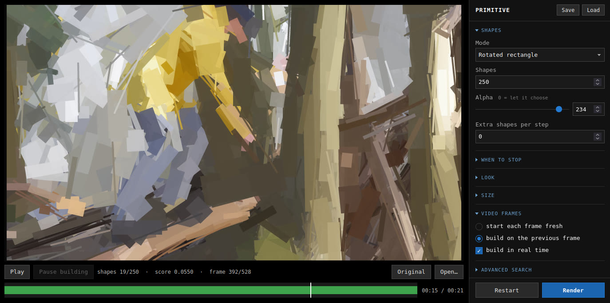

# Primitive Pictures, on the GPU

Rebuild any picture from simple shapes (triangles, rectangles, circles, curves and more), one shape at a time.

This is a Rust port of Michael Fogleman's [primitive](https://github.com/fogleman/primitive). The search for each shape runs on the graphics card with [wgpu](https://wgpu.rs) compute shaders, so it scores millions of candidate shapes per second. It comes as two programs:

- `primitive-gpu`: a command-line tool, with the same flags as the original plus a few new ones.
- `primitive-gui`: a browser interface. Drop in a picture, a video or a folder of pictures and watch the shapes appear live. It renders videos and image sequences too.



## How it works

The program starts with a canvas filled with one colour, the average colour of the target picture. Then it looks for the single shape that, drawn on top, brings the canvas closest to the target. It adds that shape and repeats. Around 50 to 200 shapes give a result that is recognisable but still abstract.

To find each shape:

1. **Random phase.** Many random shapes are scored. The best few become starting points.
2. **Climb phase.** Each starting point is nudged again and again (move a corner, change a radius, rotate). A nudge that improves the score is kept; one that does not is thrown away. This is called hill climbing. Many of these "chains" climb side by side, and a chain stops after a set number of nudges with no gain.
3. **Commit.** The best shape found is drawn onto the canvas, and the search for the next shape begins.

The colour of a shape is never searched for. For any shape, the program works out the one colour that lowers the error the most, directly from the pixels under it.

The score is the root-mean-square difference between the canvas and the target (lower is closer). With `-metric plain` it is the mean absolute difference instead, which gives flatter, bolder shapes.

### What runs on the GPU

The graphics card only *ranks* candidate shapes. Each candidate is a small fixed-size record; a compute shader draws it, finds its best colour and measures how much it would change the error, with 64 threads per candidate. The shape that wins is then drawn again on the CPU with exact whole-number maths, and the CPU result is what goes onto the canvas.

The GPU and CPU versions of the colour and blend maths give the same whole-number results, so the GPU picks the same winners as an exact CPU search would. `rust/check.sh` tests this for every shape mode (see [Testing](#testing)). Curves, rotated ellipses and polygons have anti-aliased edges that the GPU computes slightly differently; for those the GPU score is off by about 0.01%, and it picks a different winner in about 1% of batches.

Other speed-ups:

- Per-row running-sum tables, so the best colour of a whole row of pixels comes from two lookups (hard-edged shapes).
- Big batches: several batches are joined into one GPU job, and the CPU prepares the next batch while the GPU scores the current one.
- Random shapes for the next step are made on background threads while the current step runs.

## Speed

Average time for 50 shapes on a 256-pixel working size (Ryzen 7 2700, RTX 2060), over 5 seeds and 2 pictures:

| Mode | Shape | Time for 50 shapes | Candidates scored per second |
| --- | --- | ---: | ---: |
| 0 | combo | 0.57 s | 1.9 million |
| 1 | triangle | 0.36 s | 3.4 million |
| 2 | rectangle | 0.18 s | 6.3 million |
| 3 | ellipse | 0.26 s | 4.1 million |
| 4 | circle | 0.23 s | 4.3 million |
| 5 | rotated rectangle | 0.23 s | 5.0 million |
| 6 | curve | 1.01 s | 1.2 million |
| 7 | rotated ellipse | 0.72 s | 1.6 million |
| 8 | polygon | 0.64 s | 2.0 million |

## Building

You need:

- [Rust](https://rustup.rs), a recent stable version.
- A graphics card that wgpu supports (Vulkan, Metal or DirectX 12).
- [ffmpeg](https://ffmpeg.org) (with `ffprobe`) on your `PATH` for videos, video export, and pictures the `image` crate cannot open (such as HEIC). Plain PNG and JPG work without it.

```bash
cd rust
cargo build --release
```

The programs are `rust/target/release/primitive-gpu` and `rust/target/release/primitive-gui`.

This project was made and tested on Linux (Linux Mint, NVIDIA RTX 2060). The command-line tool should work anywhere wgpu does. The GUI calls a few Unix tools (`date`, `hostname`), so it may need small changes for Windows.

## Command-line use

```bash
cd rust
target/release/primitive-gpu -i ../examples/monalisa.png -o out.png -n 100 -m 1 -v
```

| Flag | Default | Description |
| --- | --- | --- |
| `i` | n/a | input image (`-` reads standard input) |
| `o` | n/a | output file: `.png`, `.jpg`, `.svg` or `.gif`. Can be given more than once. `-` writes SVG to standard output |
| `n` | n/a | number of shapes. Can be given more than once; each uses the `-m`, `-a` and `-rep` given before it |
| `m` | 1 | mode: 0=combo, 1=triangle, 2=rect, 3=ellipse, 4=circle, 5=rotatedrect, 6=beziers, 7=rotatedellipse, 8=polygon |
| `a` | 128 | shape alpha (0 lets the search choose the alpha of each shape) |
| `bg` | average | starting background colour (hex) |
| `r` | 256 | shrink large inputs to this size for the search |
| `s` | 1024 | output image size |
| `j` | all cores | number of CPU threads |
| `nth` | 1 | save every Nth frame (only with `%d` in the output path) |
| `rep` | 0 | add N extra shapes each step with a smaller search (mostly good for curves) |
| `metric` | squared | how the difference is counted: `squared` or `plain` (every mistake counts the same; flatter, bolder shapes; `-score` targets then differ) |
| `score` | off | stop early once the score is at or below this, for example 0.03; `-n` is then the most shapes |
| `v`, `vv` | off | verbose output (`-vv` adds a timing table) |

GPU search tuning:

| Flag | Default | Description |
| --- | --- | --- |
| `chains` | 16 | hill-climbing chains per shape |
| `random` | 1000 | random tries that seed each chain |
| `age` | 100 | tries without improvement before a chain stops |
| `k` | 32 | nudges each chain tries per GPU round |
| `seed` | clock | random seed; set it to make a run repeatable (with the same `-j`) |
| `raster` | gpu | who draws the candidate shapes: `gpu` or `cpu` (the older path, kept for comparison) |
| `check` | off | also score every candidate exactly on the CPU and report how far the GPU is off (slow) |

### Output formats

- **PNG, JPG:** a picture at the `-s` size, drawn with anti-aliasing.
- **SVG:** the shapes as vector graphics.
- **GIF:** an animation of the shapes being added.

With `%d` (or `%03d` and so on) in a PNG, JPG or SVG name, every frame is saved as its own file.

## Browser GUI

```bash
cd rust
target/release/primitive-gui            # then open http://localhost:8640
target/release/primitive-gui -port 9000 -j 8
```

The search runs on the computer that runs the program. You can open the page from that computer or from another device on the same network, such as a phone.

- **Input:** drop an image, a video, or a folder of pictures onto the page. Two or more pictures load as an image sequence, sorted by name with numbers in order (2 before 10).
- **Settings:** the side panel holds every setting, in sections you can open and close. Save and Load store the settings in a file and read them back. Shape mode, alpha and search tuning apply at once. Working size, background, seed and score type need a restart.
- **Stopping:** "Shapes" sets the most shapes per picture. "Stop at score" stops early once the picture is close enough, and "Fewest shapes" sets a minimum so that dark frames do not stop too soon.
- **Output size:** same as the source, 720p, 1080p, 1440p, 4K, or a custom size. Shapes are stored, so a new output size never needs a new search.
- **Image export:** PNG, JPG, SVG, or a timelapse (MP4, WebM or GIF) of the shapes being added.
- **Videos:** each frame gets the shapes that fit before the next frame is due, and every loop adds more. The timeline shows each frame as empty, partly done or done; click or drag it to jump. Each frame can start fresh, or build on the finished picture of the frame before it. "Build in real time" gives each frame exactly one frame's worth of time.
- **Render:** fills every frame and saves an MP4 or WebM (with the original sound), a GIF, or a PNG, JPG or SVG image sequence (downloadable as one zip). Renders go to `~/Videos/primitive/`.
- **File names** come from a pattern with tags: `{name}`, `{frame}`, `{shapes}`, `{mode}`, `{date}`, `{time}`. Existing files are never overwritten.
- All state lives in the program, so reloading the page, or opening it on several devices, shows the same job.

**Security:** the GUI has no password and listens on all network interfaces. Anyone on your network can use it. Never make its port reachable from the internet.

## Testing

```bash
cd rust
./check.sh      # GPU vs exact CPU scores for every mode, both GPU paths, both metrics: PASS or FAIL
./bench.sh > results.tsv    # speed: one row per mode, seed and picture
```

`check.sh` compares against `rust/check_baseline.tsv`. It must report zero mismatches for every mode on the `-raster cpu` path and for modes 1 to 5 on the default path.

## Adding a shape

Every shape is one variant of the `Shape` enum in `rust/src/shapes.rs`. Add a variant and handle it in `random`, `mutate`, `rasterize`, `gpu_supported`, `gpu_record`, `svg` and `draw`. Then add a matching `walk_*` function to `rust/src/raster_score.wgsl` and a case in its `walk` dispatcher; the layout of each kind's record is described at the top of that file. Run `./check.sh` afterwards.

## Project layout

| Path | What it is |
| --- | --- |
| `rust/src/main.rs` | the command-line program |
| `rust/src/model.rs` | the search: random phase, climb phase, commit |
| `rust/src/shapes.rs`, `raster.rs` | the shapes and their exact CPU drawing |
| `rust/src/core.rs` | the exact colour, blend and score maths |
| `rust/src/gpu.rs` | the GPU device, buffers and job queue |
| `rust/src/*.wgsl` | the compute shaders |
| `rust/src/bin/primitive-gui/` | the GUI server, video and export code |
| `rust/gui/` | the GUI page (built into the program) |
| `examples/` | test pictures |

## Credits

- **Michael Fogleman** created the original [primitive](https://github.com/fogleman/primitive) algorithm and Go program (MIT licence). This project follows its design, flags and shape modes. The example pictures come from that repository.
- **Leeuum** made this Rust and GPU port and the browser GUI.
- Written with **Claude** (Anthropic's AI model), using [Claude Code](https://claude.com/claude-code).

## Licence

MIT. See [LICENSE](LICENSE).
